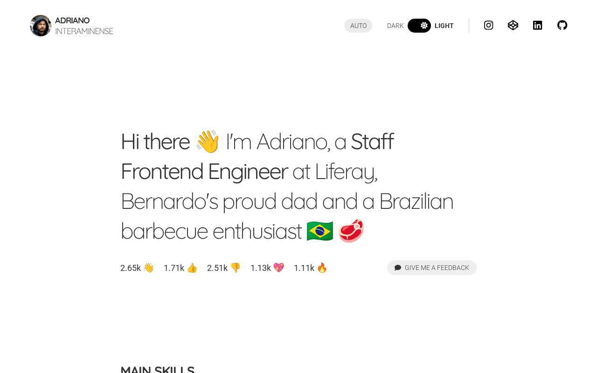

# interaminense.dev

My personal homepage: who I am, what I work with, and the side projects I build for fun.

**Live:** https://interaminense.dev



## What's in it

- **Profile:** intro, skills, a longer "about me", links and social networks.
- **Projects:** every side project with a thumbnail, tags and reactions. The featured ones are on the home page, and all of them are at `/#/projects`, newest first.
- **Reactions and feedback:** visitors can react to the profile and to each project, and leave feedback.
- **Theme:** light, dark or auto (follows the OS), from the switch in the header. The choice is saved in a cookie.
- **Admin (`/#/settings`):** sign in to edit the profile, skills, projects, tags, links and social networks, and to see analytics (page views, themes, platforms, clicks).

All content lives in Firebase Realtime Database, so updating the site doesn't need a deploy, only the admin.

## Stack

React 18 · TypeScript · Vite · Sass · Firebase (Auth + Realtime Database) · React Router · MUI (admin only) · Recharts (admin analytics) · GitHub Pages

Public pages load fast: they paint a skeleton straight from `index.html` before the JavaScript arrives, swap in content without shifting the layout, and leave the admin code (MUI, charts) in chunks that only load on admin routes.

## Running it locally

You need Node 22+ and Yarn 1.

1. Create a `.env` in the project root with your Firebase web app config:

   ```bash
   REACT_APP_FIREBASE_API_KEY=
   REACT_APP_FIREBASE_APP_ID=
   REACT_APP_FIREBASE_AUTH_DOMAIN=
   REACT_APP_FIREBASE_DATABASE_URL=
   REACT_APP_FIREBASE_MESSAGIN_SENDER_ID=
   REACT_APP_FIREBASE_PROJECT_ID=
   REACT_APP_FIREBASE_STORAGE_BUCKET=
   ```

2. Install and start:

   ```bash
   yarn install --production=false
   yarn start      # http://localhost:3000
   ```

> If your shell sets `NODE_ENV=production`, Yarn skips dev dependencies (Vite included). Install with `--production=false` and run the scripts as `NODE_ENV= yarn build`.

| Script | What it does |
| --- | --- |
| `yarn start` / `yarn dev` | Dev server with hot reload |
| `yarn build` | Type-checks and builds into `build/` |
| `yarn preview` | Serves the production build locally |
| `yarn deploy` | Builds and publishes `build/` to the `gh-pages` branch |

## Deploying

`yarn deploy` publishes to the `gh-pages` branch, which GitHub Pages serves at the custom domain in `public/CNAME`. Everything in `public/` (project thumbnails under `public/assets/thumbnails/`, the resume, `ads.txt`, `robots.txt`) ships with the build, so add new files there, never straight to `gh-pages`, where the next deploy would erase them.

## Using it for your own site

Fork it, point `.env` at your own Firebase project, update `public/CNAME` (or delete it to use `<user>.github.io`), and create your admin user in Firebase Authentication. Then sign in at `/#/settings` and fill in your profile.

## Project layout

```
index.html              Entry page, including the static loading skeleton
src/
  pages/                Routes (public pages + lazy-loaded admin pages)
  components/           Public UI (layout, cards, skeletons, reactions, …)
  components/admin/     Admin UI (MUI)
  firebase/             Auth and database wrappers
  css/                  Global styles and the loading primitives
public/                 Static files copied as-is into the build
```
